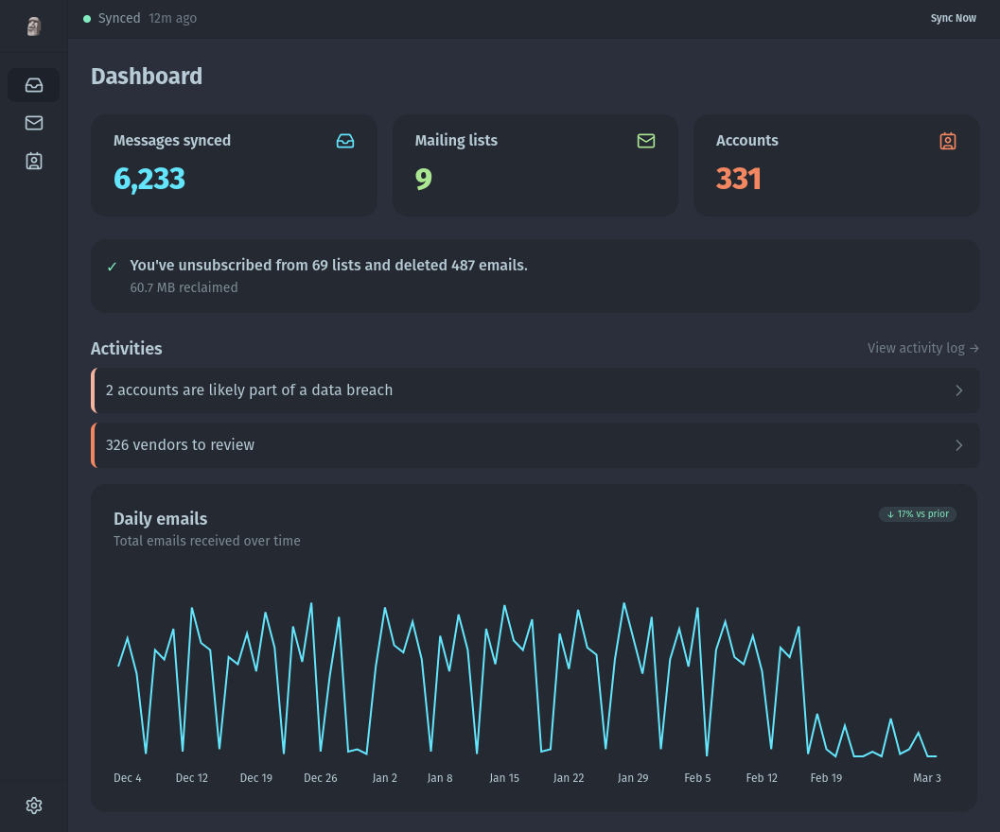

# Paperweight 🗿

**Your inbox knows where your data lives. We help you take back control.**



Every account you create, every service you sign up for, every online purchase is connected to your email address. Most people have 100+ accounts they've forgotten about, creating security risks and privacy exposure.

Paperweight scans your inbox to map your digital footprint, then helps you take back control and delete your data.

Local-first. Your data stays on your computer. Respecting your privacy by default.

## Features

- **Marketing/Bulk unsubscribe** — Find an unsubscribe from marketing and bulk mailing lists in minutes
- **Account inventory** — Discover which vendors and services have your data
- **Breach alerts** — Know when companies you use get breached (via haveibeenpwned.com)
- **GDPR deletion support** — Generate data deletion requests to reduce exposure
- **Local-first** — Your emails and settings stay on your machine
- **Privacy-respecting** — No data sent to external servers
- **Open development** — Built in public, source code available for audit

## Email Providers

- ✅ Custom IMAP
- ✅ Google / Gmail
- ✅ Microsoft
- ✅ Apple
- ✅ Proton Mail (via Bridge)

IMAP Presets: Proton, Yahoo Mail, Fastmail, Yandex, Zoho, Mailbox.org, Posteo, GMX.

## Quick Start

1. Download [latest release](https://github.com/wslyvh/paperweight/releases) for your platform
2. Connect your email
3. Scan your inbox in ~2 minutes
4. Review your footprint; use Pro to unsubscribe and delete emails

## System requirements

- **macOS:** 13 Ventura or later, Intel or Apple Silicon.
- **Windows:** Windows 10 or later, x64.
- **Linux:** x64, distributed as AppImage and Debian packages.

These requirements apply to the next Electron 45-based release. For an older
release, check its release notes. Changes to requirements are announced in
release notes; automatic updates must respect the minimum supported OS.

## License

Discover, inspect, and curate your digital footprint for free. Upgrade to Pro to execute cleanup and support open-source development.

- **Free**: One email account, full-history sync, account and mailing-list discovery, breach and personal-data overviews, and local curation
- **Cleanup Pass**: Full Pro access for 30 days of focused cleanup. One payment, no renewal. Community support on GitHub.
- **Paperweight Pro**: Maintain your privacy all year, with email support included.

Both paid plans unlock unsubscribe, trash, spam, bulk cleanup actions, privacy requests and follow-ups, multiple email accounts, and MCP access. Card and manual crypto payments are available for both plans.

[View plans and pricing →](https://www.paperweight.email/pricing)

## Development

Use Node.js 24. CI and the commands below use Yarn Classic 1.22.22 with frozen
lockfiles. Other local package managers are fine, but only Yarn lockfiles belong
in the repository. Dependency upgrades are deliberate.

Released binaries ship with OAuth credentials configured. Building from source needs your own.

```bash
yarn install --frozen-lockfile
yarn --cwd analysis install --frozen-lockfile
yarn install-electron
cp .env.example .env   # then fill in the three IDs below
yarn dev
```

OAuth values are baked in at build time (`electron.vite.config.mts`). Empty `.env` values compile to empty strings and auth fails at runtime.

**Google / Gmail** — https://console.cloud.google.com/
- Create OAuth 2.0 credentials, application type "Desktop app"
- Enable the Gmail API
- Add scope `https://www.googleapis.com/auth/gmail.modify` on the consent screen
- Add yourself as a test user while the app is in testing mode
- Set `GOOGLE_CLIENT_ID` and `GOOGLE_CLIENT_SECRET` in `.env`

**Microsoft** — https://portal.azure.com/
- Register an app, supported account types "Personal + work/school"
- Authentication → add "Mobile and desktop applications" with redirect URI `http://localhost`
- API permissions → Microsoft Graph → Delegated → `User.Read`, `Mail.ReadWrite`, `Mail.Send`, `offline_access`, `openid`, `profile`
- Set `MICROSOFT_CLIENT_ID` in `.env` (no secret; the flow uses PKCE)

IMAP accounts need no OAuth env vars.

`yarn typecheck`, `yarn test` and `yarn test:analysis` run the local checks.
`yarn test:smoke` checks app startup, saved data and OS-backed credential storage;
`yarn test:mcp` checks the MCP launcher and protocol. On headless Linux, install
Xvfb, D-Bus and GNOME Keyring, then use
`bash scripts/test-linux-desktop.sh yarn test:all` for an isolated test session.
Tests use synthetic profiles and do not need mailbox or signing credentials.

The **Test** GitHub workflow runs on Linux, Windows and macOS Intel/Apple Silicon
for pull requests and main-branch pushes. It can also be run manually and is
reused by release builds. It tests unpacked app bundles and retains failure logs
and screenshots for seven days. Real OAuth login and signed installer/update
prompts remain release checks.

## Contributing

Feedback, bug reports, and PRs are welcome.

**Language lexicons** — Paperweight's analysis engine classifies mail
(purchases, updates, promotions) and finds unsubscribe links using
per-language phrase lexicons. English and Dutch are curated; other languages
need native speakers. Adding or improving a language is a single-file data
contribution — no engine knowledge required. See
[`analysis/src/data/lexicons/README.md`](analysis/src/data/lexicons/README.md)
for the rules.
